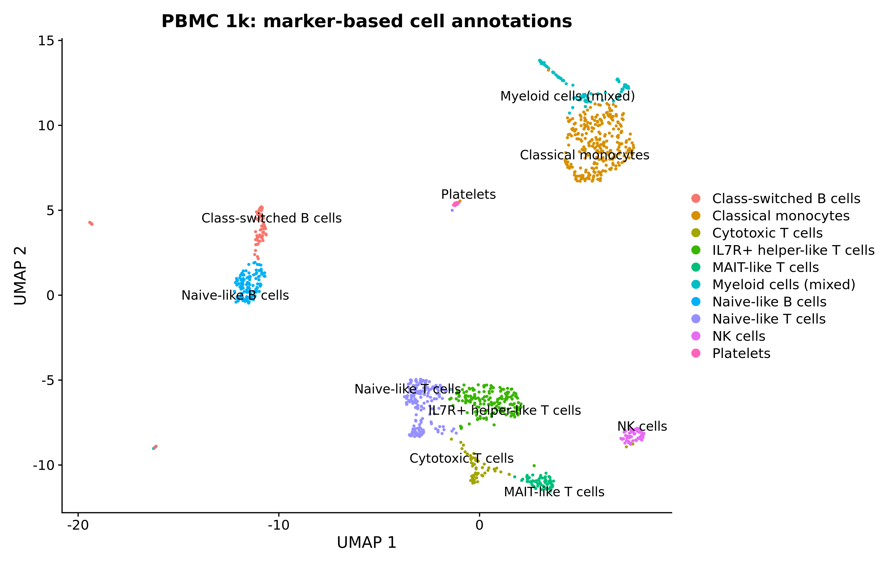
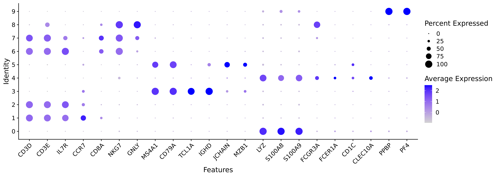

# PBMC single-cell RNA-seq analysis: STARsolo and Seurat

Analysis of public 10x Genomics PBMC 1k v3 data, starting from raw FASTQs and ending with marker-based cell annotations. Processing was performed on an HPC system using Slurm.

## Dataset and tools

- Dataset: 10x Genomics PBMC 1k, Chromium 3′ v3 chemistry.
- Input: R1 and R2 FASTQs from two sequencing lanes of the same sample.
- Reference: 10x GRCh38 2024-A genome and gene annotation.
- Barcode whitelist: 3M-february-2018.
- Tools: STAR 2.7.11b/STARsolo, Seurat 5.5.1, scDblFinder, R, Conda, and Slurm.

R1 contains the 16-base cell barcode and 12-base UMI. R2 contains the transcript sequence. Both lanes were processed together.

Raw FASTQs:
https://cf.10xgenomics.com/samples/cell-exp/3.0.0/pbmc_1k_v3/pbmc_1k_v3_fastqs.tar

Reference:
https://cf.10xgenomics.com/supp/cell-exp/refdata-gex-GRCh38-2024-A.tar.gz

## Workflow

1. Download data, reference, and barcode whitelist.
2. Build the STAR genome index.
3. Run STARsolo alignment, exon-based gene counting, UMI deduplication, and EmptyDrops_CR cell calling.
4. Examine detected genes, total UMI counts, and mitochondrial count percentage.
5. Retain cells with 200–5,000 detected genes and ≤20% mitochondrial counts.
6. Apply LogNormalize, select 2,000 variable genes, scale expression, and run PCA.
7. Construct the neighbor graph and perform Louvain clustering at resolution 0.4 using PCs 1–20.
8. Generate UMAP visualizations and identify cluster-associated markers.
9. Predict doublets using scDblFinder.
10. Remove predicted doublets and repeat normalization, dimensional reduction, clustering, and marker analysis.
11. Assign cell annotations using marker expression and investigate the heterogeneous myeloid cluster.

## Results

| Metric | Result |
|---|---:|
| Sequencing reads processed | 66,601,887 |
| Reads with valid barcodes | 97.59% |
| Uniquely mapped reads | 87.91% |
| STARsolo-called cells | 1,227 |
| Cells retained after QC | 1,118 |
| Predicted doublets removed | 32 |
| Retained predicted singlets | 1,086 |
| Final clusters | 10 |

### Annotated UMAP

### Marker expression

Dot size indicates the percentage of cells expressing a gene. Color indicates scaled average expression.

## Cell annotations

| Cluster | Cells | Annotation |
|---|---:|---|
| 0 | 284 | Classical monocytes |
| 1 | 172 | Naive-like T cells |
| 2 | 170 | IL7R+ helper-like T cells |
| 3 | 119 | Naive-like B cells |
| 4 | 84 | Myeloid cells (mixed) |
| 5 | 69 | Class-switched B cells |
| 6 | 65 | MAIT-like T cells |
| 7 | 56 | Cytotoxic T cells |
| 8 | 52 | NK cells |
| 9 | 15 | Platelets |

Annotations are based on combinations of cluster markers and canonical marker expression. Specific subtype labels remain provisional. Cluster 4 contains distinct myeloid marker patterns and was retained under a broad label.

## Scripts

| R script | Purpose |
|---|---|
| 01_qc.R | Load STARsolo counts and examine cell quality |
| 02_filter.R | Apply cell QC thresholds |
| 03_cluster.R | Normalize, run PCA, cluster, and generate UMAP |
| 04_markers.R | Identify initial cluster markers |
| 05_doublets.R | Predict doublets |
| 06_singlets.R | Retain predicted singlets and recluster |
| 07_singlet_markers.R | Identify markers for the final clusters |
| 08_check_myeloid.R | Inspect the heterogeneous myeloid cluster |
| 09_annotate.R | Assign annotations and save final outputs |

The accompanying `.sbatch` files install software, prepare inputs, and run the analysis on compute nodes.

## Running the workflow

Run jobs from the project root. Create `logs/` before submitting jobs because Slurm opens log files before the script starts.

The scripts expect:

- FASTQs under `data/raw/pbmc_1k_v3_fastqs/`
- Reference files and STAR index under `reference/`
- Software environments under `envs/star`, `envs/seurat`, and `envs/doublet`
- Analysis outputs under `results/`

Complete setup, downloads, and index generation before submitting `run_starsolo.sbatch`. After STARsolo finishes, submit the R analysis jobs in numbered order, waiting for each required preceding step to finish successfully.

Slurm partition and resource settings may need adjustment on another cluster. Installation scripts describe environment setup; exact package versions should be checked against the saved session information.

## Interpretation and limitations

The analysis recovered expression profiles consistent with major PBMC populations and demonstrates processing from raw reads to cell annotations.

This is a descriptive analysis of one public sample. It does not test a disease or treatment effect, perform long-read or isoform analysis, or establish novel biological findings.

QC thresholds, the number of PCs, and clustering resolution were initial analysis choices; parameter sensitivity was not systematically evaluated. Doublet calls are computational predictions. Dedicated ambient-RNA correction was not performed.

Raw data, reference indexes, installed environments, and large RDS objects are excluded from this repository.
